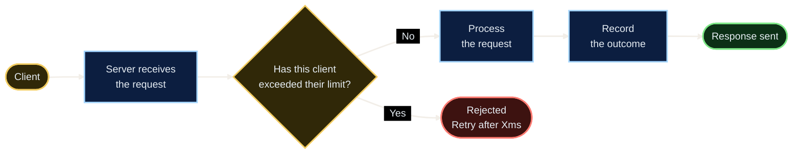

# Build a Rate Limiter from Scratch

One client fires requests faster than your server can handle them. Every other client starts timing out. The culprit? A buggy script that didn't even mean any harm. The thing that stops this is a rate limiter. Stripe has one. GitHub has one. Cloudflare has one. You're about to build yours, from the first byte.

---

### The Problem

A server that accepts every request unconditionally is a server that one bad actor can take down. It doesn't have to be a malicious attack: a misconfigured script, a retry loop without backoff, a client that just doesn't know better. The moment one caller consumes all available capacity, every other caller gets timeouts. The system goes down, and the cause was a single client that shouldn't have been served that many times.

A rate limiter sits in front of your logic and says: *"You've had your fair share. Come back later."* Simple idea. Genuinely hard to build correctly.

---

### How the Decision Happens

When a request arrives, the server asks one question before doing anything else: *has this client already used up their allowance for this window of time?*

If no: process the request, record the outcome, send back the result. If yes: turn them away immediately and tell them exactly how long to wait. Don't waste a single CPU cycle doing real work for someone who shouldn't be served.

That's the whole decision. Simple at a glance, but every box in that diagram hides a problem worth understanding.

---

### What You'll Build

The network doesn't know what a `Request` is: it moves bytes. So the first thing you'll build is the layer that turns bytes into objects and back: **serialization** over raw **TCP sockets**. That's the wire contract both sides of the connection depend on, and it's the layer every framework hides from you.

Then you'll make the server handle many clients at once without collapsing. That's **virtual threads**: Java 21's way of running thousands of simultaneous connections at almost no cost, because the JVM parks a thread the moment it blocks on I/O instead of tying up a real OS thread.

Then comes the rate limiter itself, which has to make correct decisions when dozens of threads are checking the same client's count simultaneously. A plain `count++` is three operations (read, add, write), and two threads racing on it silently lose increments. That's where **atomic types** and the **CAS loop** come in: hardware-level operations that make a read-modify-write uninterruptible.

Finally, you'll add an event log and query engine that remembers every decision, using **Java Streams** to answer live analytics questions about who's sending traffic and how fast the server is responding.

---

### What You'll Experience

The obvious approach to counting requests has a flaw that only shows up under load. You'll hit it, understand exactly why it breaks, and fix it, not by guessing but by understanding what happens at the instruction level when two threads race on the same memory location.

A global rate limit sounds simpler than per-client limits, until one bad actor eats everyone else's quota. You'll build the version that's actually fair and run the experiment that proves it: two clients, same server, same window: one rate-limited, the other sailing through unaffected.

You'll build the serialization layer from scratch and see a Java object cross a network connection and arrive intact on the other side. That's the moment frameworks stop being magic.

At the end, you'll fire a burst of requests and watch rejections kick in at exactly the right moment. That's your code enforcing fairness in real time.

---

### What the Server Can Tell You

The server doesn't just make decisions: it remembers them. Every request, whether allowed or blocked, gets recorded. Once your server is running, you can query it live:

| Query | What it answers |
|---|---|
| **Total requests** | How many requests has the server handled in total, across all clients? |
| **Top clients** | Who are the busiest callers? Returns the top 5 clients ranked by request count. |
| **Average latency** | How fast is the server responding on average, in milliseconds? |

These aren't hypothetical. Your finished client fires these queries at the real running server and prints the answers live as traffic flows through.

---

### The Finished System

```mermaid
---
config:
  theme: redux-dark-color
  themeVariables:
    darkMode: true
    background: "#0d1117"
    canvasBackground: "#161b22"
    primaryTextColor: "#e6edf3"
    textColor: "#f0f6fc"
    primaryColor: "#ff7b72"
    primaryColor2: "#ffa657"
    primaryColor3: "#f2cc60"
    primaryColor4: "#7ee787"
    primaryColor5: "#56d4dd"
    primaryColor6: "#a5d6ff"
    primaryColor7: "#d2a8ff"
---
flowchart TB
    subgraph clients ["<div style="margin-top:6px"/>Clients"]
        direction TB
        A(["alice"]) & B(["bob"]) & C(["carol"]) & D(["john"]) & E(["jane"])
    end

    NET["TCP Listener<br />accept loop"]

    subgraph vts ["<div style="margin-top:6px"/>Virtual Threads"]
        direction TB
        VT1(["VT-1"]) & VT2(["VT-2"]) & VT3(["VT-3"])
    end

    RL["Rate Limiter<br />per-client · lock-free CAS"]
    REJ(["RATE_LIMITED<br />Retry after Xms"])

    subgraph pipe ["<div style="margin-top:6px"/>Request Pipeline"]
        direction LR
        
        RH["Request Handler"] --> LOG["Request Log"] --> AN["Analytics Service"]
    end

    RES(["Response"])

    clients --> NET
    NET --> vts
    vts --> RL
    RL -->|"&nbsp;&nbsp;blocked&nbsp;&nbsp;"| REJ
    RL -->|"&nbsp;&nbsp;allowed&nbsp;&nbsp;"| pipe
    pipe --> RES

    style A   fill:#3d1e08,stroke:#ffa657,color:#e6edf3,stroke-width:2px
    style B   fill:#3d1e08,stroke:#ffa657,color:#e6edf3,stroke-width:2px
    style C   fill:#3d1e08,stroke:#ffa657,color:#e6edf3,stroke-width:2px
    style D   fill:#3d1e08,stroke:#ffa657,color:#e6edf3,stroke-width:2px
    style E   fill:#3d1e08,stroke:#ffa657,color:#e6edf3,stroke-width:2px
    style NET fill:#0d2d5e,stroke:#56d4dd,color:#e6edf3,stroke-width:2px
    style VT1 fill:#0c1e40,stroke:#a5d6ff,color:#e6edf3,stroke-width:2px
    style VT2 fill:#0c1e40,stroke:#a5d6ff,color:#e6edf3,stroke-width:2px
    style VT3 fill:#0c1e40,stroke:#a5d6ff,color:#e6edf3,stroke-width:2px
    style RL  fill:#302808,stroke:#f2cc60,color:#e6edf3,stroke-width:2px
    style REJ fill:#3d1210,stroke:#ff7b72,color:#e6edf3,stroke-width:2px
    style RH  fill:#0c3016,stroke:#7ee787,color:#e6edf3,stroke-width:2px
    style LOG fill:#0c3016,stroke:#7ee787,color:#e6edf3,stroke-width:2px
    style AN  fill:#0c3016,stroke:#7ee787,color:#e6edf3,stroke-width:2px
    style RES fill:#0c3016,stroke:#7ee787,color:#e6edf3,stroke-width:2px
    style clients fill:#1f1004,stroke:#ffa657
    style vts     fill:#060f1f,stroke:#a5d6ff
    style pipe    fill:#061410,stroke:#7ee787
```

---

### The Real-World Connection

The ideas here are the same ones inside Stripe's payment API, GitHub's developer rate limits, and Cloudflare's DDoS mitigation, behind every `429 Too Many Requests` you've ever gotten from an API. Their systems run across thousands of servers. Yours runs on one. The reasoning and the algorithm are identical. The only difference is scale.

Every user gets exactly their fair share, no more, no less, regardless of what anyone else does. By step 12, you won't just believe it. You'll have run the experiment that proves it.
